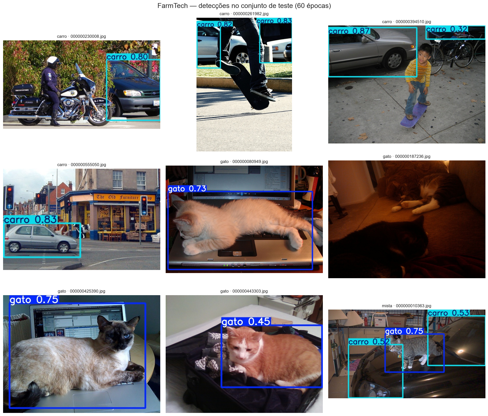
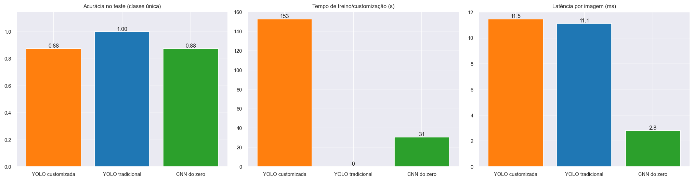
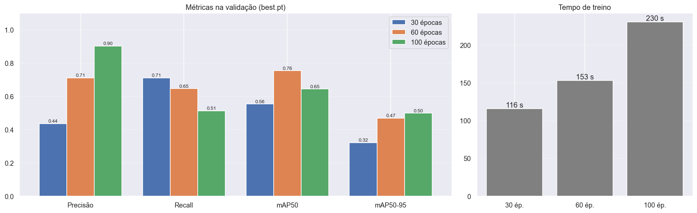
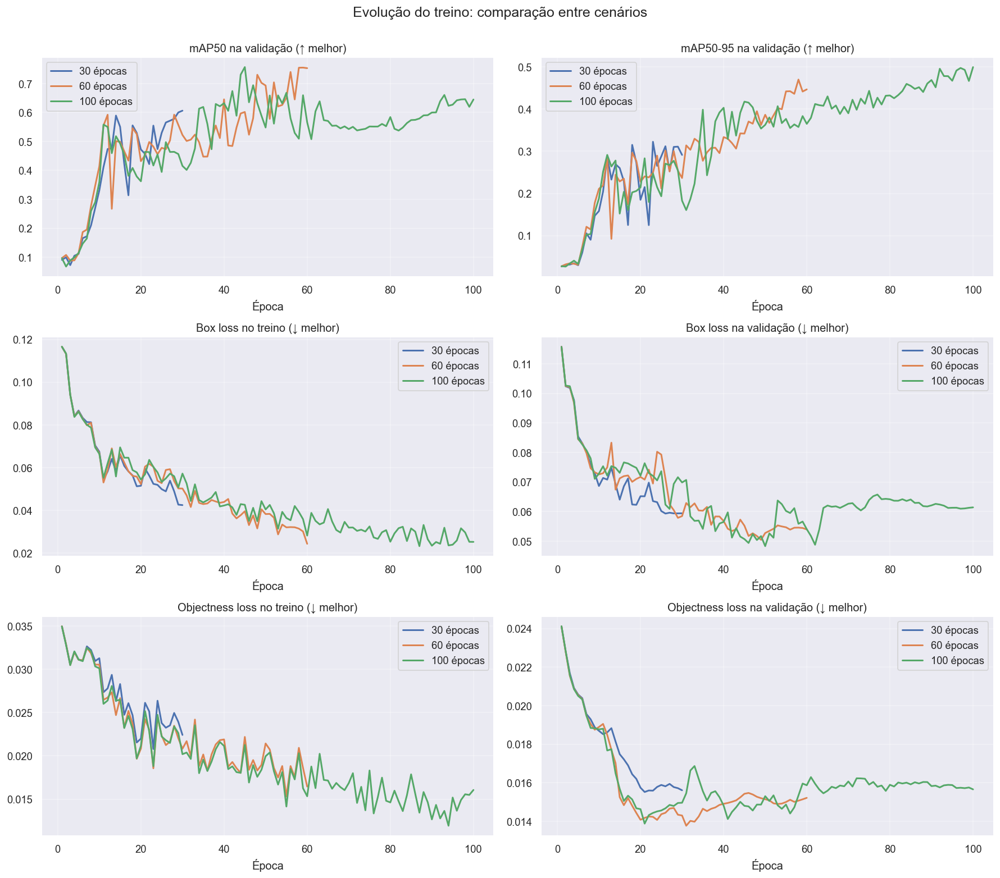

# 🐱🚗 FarmTech Solutions — Visão Computacional com YOLOv5

**FIAP · Fase 6 · PBL — Entregas 1 e 2**

| Integrante | RM |
|---|---|
| Victor Vergara Koshikene | 568813 |
| Leonardo Lima de Queiroz | 573539 |
| Vinicius Prado Speria | 572741 |
| Leonardo Ribeiro de Souza | 571534 |
| Matheus Costa Manzoli Machado | 571814 |

[](https://colab.research.google.com/github/koshivv/fiap-farmtech_solutions-fase06/blob/main/VictorVergaraKoshikene_rm568813_pbl_fase6.ipynb)

🎥 **Vídeo de demonstração (YouTube, não listado):** [assistir aqui](COLE_AQUI_O_LINK_DO_VIDEO)

---

## Sobre o projeto

A FarmTech Solutions expandiu seus serviços de IA para além do agronegócio, incluindo saúde animal, segurança patrimonial e controle de acesso. Este projeto simula a visita a um cliente que quer entender, na prática, como funciona um sistema de **visão computacional**, usando duas classes bem diferentes entre si:

| Classe | Exemplo de aplicação |
|---|---|
| `gato` | monitoramento de animais em propriedades |
| `carro` | segurança patrimonial e controle de acesso de veículos |

O trabalho está dividido em duas partes, no mesmo notebook:

- **Entrega 1:** treino de um **YOLOv5 customizado** com o nosso dataset, comparando três cenários de treino (**30, 60 e 100 épocas**) em acurácia, erro e desempenho.
- **Entrega 2:** comparação da YOLO customizada com duas abordagens concorrentes, a **YOLO tradicional** (pré-treinada no COCO, sem customização) e uma **CNN treinada do zero**, em facilidade de uso, precisão, tempo de treinamento e tempo de inferência.

> 📓 **A solução das Entregas 1 e 2 está documentada no notebook** [`VictorVergaraKoshikene_rm568813_pbl_fase6.ipynb`](VictorVergaraKoshikene_rm568813_pbl_fase6.ipynb), com código comentado, saídas e análises. Este README é apenas um guia de entrada.

## Como o notebook está organizado

**Parte 1 — Entrega 1: YOLO customizada**

1. Configuração do ambiente (GPU e Google Drive)
2. Construção do dataset a partir do COCO 2017
3. Rotulação no Make Sense AI
4. Controle de qualidade dos rótulos
5. Preparação dos dados para o YOLOv5
6. Treinamento dos cenários de épocas
7. Avaliação e comparação na validação
8. Teste em imagens nunca vistas
9. Conclusões, pontos fortes e limitações

**Parte 2 — Entrega 2: comparação com abordagens concorrentes**

11. Preparação do ambiente da Parte 2
12. YOLO tradicional (pré-treinada no COCO)
13. CNN treinada do zero
14. Comparação das três abordagens
15. Avaliação crítica das abordagens

## Dataset em resumo

- **Origem:** imagens do [COCO 2017](https://cocodataset.org) (conjunto `val2017`, que não foi usado no pré-treino do YOLOv5, evitando vazamento de dados).
- **Composição:** 40 imagens de gato e 40 de carro (32 treino / 4 validação / 4 teste cada), mais 5 imagens extras com os dois objetos.
- **Rotulação:** feita manualmente no [Make Sense AI](https://www.makesense.ai), em formato YOLO.

## Destaques dos resultados

**Entrega 1:** entre os cenários de épocas, o de **60 épocas** foi o recomendado, com o melhor mAP50 na validação e o melhor equilíbrio entre precisão, recall e tempo de treino.



**Entrega 2:** para gatos e carros, a **YOLO tradicional** igualou ou superou a customizada em quase todas as métricas, sem rotulação nem treino, pois essas classes já existem no COCO. A customização continua sendo o caminho para objetos fora do COCO. A CNN do zero foi a mais rápida na inferência, mas a menos estável e não localiza objetos.



<details>
<summary>Mais gráficos da Entrega 1</summary>




</details>

As análises completas, incluindo limitações, estão nas Seções 9 e 15 do notebook.

## Ir Além — Opção 2: Transfer Learning, Fine Tuning e Segmentação

Transfer Learning com fine tuning (EfficientNetB0) contra a CNN do zero e pré-segmentação do objeto antes da classificação: **[`ir_alem_opcao2/`](ir_alem_opcao2/README.md)** (três notebooks, código em `src/`, resultados e figuras).

## Estrutura do repositório

```
├── VictorVergaraKoshikene_rm568813_pbl_fase6.ipynb   # notebook com a solução completa (Entregas 1 e 2)
├── README.md
├── assets/                                           # imagens usadas neste README
├── ir_alem_opcao2/                                   # Ir Além — Opção 2 (ver o README próprio)
└── dataset/
    ├── manifesto_dataset.csv                         # origem, grupo e divisão de cada imagem
    └── labels/
        ├── treino/                                   # rótulos YOLO do treino (67)
        └── validacao/                                # rótulos YOLO da validação (9)
```

As imagens não estão no repositório. O notebook as baixa diretamente do COCO, com base no manifesto, e copia os rótulos deste repositório quando eles não estão no Google Drive de quem executa.

## Como executar

1. Clique no botão **Abrir no Colab** no topo desta página.
2. Ative a GPU em **Runtime → Change runtime type → T4 GPU**.
3. Execute **Runtime → Run all** e autorize o acesso ao Google Drive quando solicitado.

O notebook cria a pasta `MyDrive/FarmTech_Fase6` no Drive de quem executa, com imagens, rótulos e resultados.

> Como o treino em GPU não é totalmente determinístico, uma nova execução pode gerar métricas ligeiramente diferentes das registradas no notebook.

## Créditos e fontes

- **Dataset:** Lin, T.-Y. et al. *Microsoft COCO: Common Objects in Context*. ECCV, 2014. Anotações sob licença CC BY 4.0; imagens do Flickr com licenças individuais, registradas no `manifesto_dataset.csv`.
- **Modelos:** [Ultralytics YOLOv5](https://github.com/ultralytics/yolov5) e [PyTorch](https://pytorch.org).
- **Rotulação:** [Make Sense AI](https://www.makesense.ai).
