# Ir Além — Opção 2: Transfer Learning, Fine Tuning e Segmentação

**FIAP · Fase 6 · PBL — FarmTech Solutions**

| Integrante | RM |
|---|---|
| Victor Vergara Koshikene | 568813 |
| Leonardo Lima de Queiroz | 573539 |
| Vinicius Prado Speria | 572741 |
| Leonardo Ribeiro de Souza | 571534 |
| Matheus Costa Manzoli Machado | 571814 |

| Notebook | Conteúdo | Colab |
|---|---|---|
| [01 — Transfer Learning](notebooks/01_transfer_learning.ipynb) | CNN do zero × EfficientNetB0 com fine tuning (H1) | [](https://colab.research.google.com/github/koshivv/fiap-farmtech_solutions-fase06/blob/main/ir_alem_opcao2/notebooks/01_transfer_learning.ipynb) |
| [02 — Segmentação](notebooks/02_segmentacao_mascaras.ipynb) | Escolha do segmentador, máscaras, política de falha | [](https://colab.research.google.com/github/koshivv/fiap-farmtech_solutions-fase06/blob/main/ir_alem_opcao2/notebooks/02_segmentacao_mascaras.ipynb) |
| [03 — Comparação final](notebooks/03_comparacao_final.ipynb) | Matriz 2×2, ablações e conclusões (H2) | [](https://colab.research.google.com/github/koshivv/fiap-farmtech_solutions-fase06/blob/main/ir_alem_opcao2/notebooks/03_comparacao_final.ipynb) |

🎥 **Vídeo (YouTube, não listado, até 5 min):** [assistir aqui](COLE_AQUI_O_LINK_DO_VIDEO)

---

## Objetivo

Na Entrega 2, uma CNN treinada do zero com 64 imagens classificou `gato` × `carro` (imagens do COCO) com 7/8 acertos no
teste, mas com treino instável. Este "Ir Além" avalia duas formas de melhorar essa classificação:

- **H1:** uma rede grande pré-treinada na ImageNet (EfficientNetB0, com fine tuning) classifica melhor que a CNN do zero?
- **H2:** pré-segmentar o objeto e apagar o fundo facilita a classificação?

## Pipeline

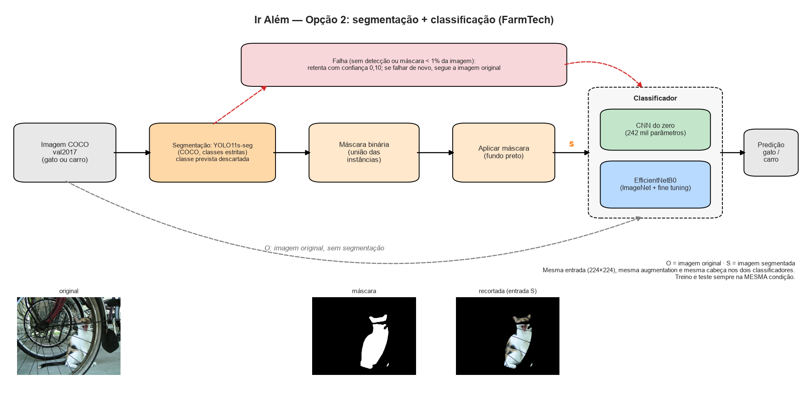

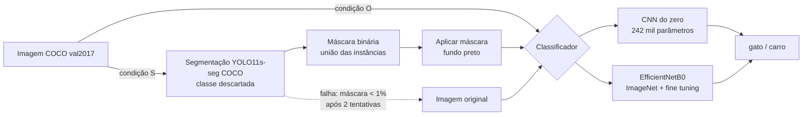

## Metodologia

### Dados

- **Mesmos splits das Entregas 1 e 2:** 64 imagens de treino (32 gatos, 32 carros), 8 de validação e 8 de teste de classe
  única. As 5 imagens mistas (gato + carro) ficam fora da classificação. A seleção da Entrega 1 foi refeita a partir das
  anotações oficiais do COCO e reproduz exatamente o `dataset/manifesto_dataset.csv`.
- **Teste ampliado (52 imagens):** com só 8 imagens de teste, cada erro vale 12,5 pontos percentuais. Com os **mesmos
  filtros** da Entrega 1 sobravam 70 gatos e 26 carros no COCO val2017; usamos os 26 carros e sorteamos 26 gatos (semente
  42), lista em [`dados/manifesto_teste_ampliado.csv`](dados/manifesto_teste_ampliado.csv). O rótulo vem do COCO (sem
  rotulação manual), nenhuma é quase-duplicata das 85 originais (dHash) e elas não foram usadas em nenhuma decisão.
  **As conclusões se baseiam nesse conjunto**; o teste original é reportado para comparação com a Entrega 2.
- **Máscaras GT do COCO** (polígonos anotados por humanos) servem só para medir a segmentação e para a ablação "oráculo".

### Classificadores (Keras 3)

| | CNN do zero | Transfer Learning |
|---|---|---|
| Arquitetura | port da CNN da Entrega 2: 4 × (Conv 3×3 + BN + ReLU + MaxPool), mesmos 241.794 parâmetros | EfficientNetB0 (`keras.applications`, pesos ImageNet) |
| Entrada | 224×224 (a Entrega 2 usava 128; o *global average pooling* aceita qualquer tamanho), normalização para [-1, 1] dentro do modelo | 224×224, pixels em [0, 255] (normalização ImageNet já embutida no modelo) |
| Cabeça | GAP → Dropout 0,3 → Dense(2) | igual |
| Treino | Adam 1e-3, 100 épocas | fase 1: base congelada, Adam 1e-3, 30 épocas; fase 2: fine tuning a partir do melhor checkpoint da fase 1, Adam 1e-5, 30 épocas |
| Augmentation | RandomResizedCrop, espelhamento, rotação ±10°, brilho/contraste/saturação ±30% (igual à Entrega 2) | igual |
| Checkpoint | menor entropia cruzada na validação | igual (o modelo final é o melhor da fase 2) |

**Por que EfficientNetB0:** maior acurácia na ImageNet entre as redes de até ~5 M de parâmetros do `keras.applications`
(77,1% top-1 com 5,3 M, contra 71,3% da MobileNetV2; a InceptionV3 ganha 0,8 p.p. com 4,5× mais parâmetros e a VGG16 tem
138 M) e normalização embutida, o que deixa o pipeline idêntico para imagens originais e segmentadas. Redes maiores
(ResNet50, VGG16) teriam milhões de parâmetros só no último estágio para 64 imagens de treino.

**Camada de congelamento:** na fase 2 liberamos, pelo nome, de `block7a_expand_conv` até o fim da base: **N = 16 camadas**
(o último bloco MBConv e a convolução de topo), das quais 6 têm pesos treináveis, ~1,1 M de parâmetros (27,7% da base,
~17,5 mil por imagem de treino). Liberar a partir do `block6a` daria 3,1 M (77% da base) para 64 imagens; liberar só a
`top_conv` ficaria próximo de não fazer fine tuning. O corte respeita a fronteira de um bloco, como recomenda o exemplo
oficial do Keras. As BatchNormalization continuam congeladas (estatísticas da ImageNet) e o *stochastic depth* da
EfficientNet é desligado, para que a base produza as mesmas features no treino e na inferência (no Keras 3, chamar a base
com `training=False` não basta: o `fit` sobrescreve esse argumento nas camadas internas).

**O que a H1 compara:** entrada, augmentation e cabeça iguais eliminam diferenças de pipeline, mas a comparação continua
sendo "arquitetura grande pré-treinada × CNN pequena treinada do zero", como pede o enunciado; ela não isola o efeito do
pré-treino sozinho.

**Backend:** o código usa só a API do Keras 3. Ele roda com o backend TensorFlow quando o TF enxerga a GPU e com o backend
PyTorch caso contrário. No runtime do Colab usado na Entrega 1 (PyTorch +cu130), o TensorFlow pré-instalado registrou
`Could not find cuda drivers ... GPU will not be used`, enquanto o PyTorch usou a T4.

### Segmentação

- **Gato e carro são classes do COCO**, então segmentadores pré-treinados no COCO (*train2017*) funcionam sem treino nas
  nossas imagens (*val2017*, que a Ultralytics usa como validação: a qualidade medida pode ser levemente otimista).
  Candidatos: YOLO11s-seg, YOLO26n-seg e caixas do YOLO26n-seg refinadas pelo SAM 2.1, com conjunto de classes estrito
  {cat, car} ou amplo (veículos e animais).
- **Escolha só com treino + validação**, pelo maior IoU médio contra as máscaras GT (falha conta como IoU 0); empate
  (diferença ≤ 0,01) → menos falhas → classes estritas → modelo mais simples.
- **Regras anti-vazamento:** a classe prevista pelo segmentador é descartada (a máscara é a união das instâncias); a
  política de falha é a mesma para as duas classes (máscara < 1% → nova tentativa com confiança 0,10 → senão, imagem
  original, também no treino); a acurácia que o segmentador teria sozinho é reportada à parte.
- **Ablação (implementada, não executada):** o detector da Entrega 1, treinado no nosso split de treino, gerando caixas para
  o SAM 2.1, para medir a diferença de qualidade das máscaras entre treino e teste. O retreino do YOLOv5 levaria cerca de
  1 dia em CPU; a seção roda no Colab com GPU ou com os pesos originais em `FARMTECH_PESOS_E1` (notebook 02, Seção 11),
  mas não foi testada de ponta a ponta.

### Desenho experimental

| Classificador | Imagem original (O) | Imagem segmentada (S) |
|---|---|---|
| CNN do zero | treino O → teste O | treino S → teste S |
| Transfer Learning | treino O → teste O | treino S → teste S |

- Cada célula treina e testa **na mesma condição**; o efeito de treinar em uma e testar em outra aparece à parte.
- 5 sementes por célula (média ± desvio padrão); mesmos dados, entrada, augmentation e cabeça.
- Métricas: acurácia, precisão/recall/F1 por classe, matriz de confusão, curvas, log-loss, Brier, latência por imagem;
  teste de McNemar exato sobre o consenso das sementes (p ajustado por Holm dentro de cada hipótese) e intervalo de
  confiança de 95% por *bootstrap*.
- Ablações: **C**, a imagem segmentada (fundo preto) recortada pela caixa da máscara com 10% de folga, que separa "apagar o
  fundo" de "ampliar o objeto"; **G**, fundo apagado com a máscara humana do COCO ("oráculo"); um classificador que só vê a
  área da máscara; e estratos com/sem pessoa na cena (há pessoas em cerca de 2/3 das fotos de carro e em menos de 10% das
  de gato).
- Hiperparâmetros fixados a priori em [`src/config.py`](src/config.py) e regras de decisão fixadas no notebook 02 antes de
  olhar os testes: treino + validação escolhem o segmentador e a validação escolhe o checkpoint. Os testes foram
  avaliados no fim.

## Resultados

Execução de referência: local, CPU (Windows, 12 threads), Keras 3.13.2 com backend PyTorch 2.14.1, ultralytics 8.4.175.
Os números abaixo são do **teste ampliado** (52 imagens), média ± desvio padrão de 5 sementes, salvo indicação. Todas as
previsões, imagem a imagem, estão em [`resultados/`](resultados/).

### Segmentação (notebook 02)

| Candidato (treino + validação, 76 imagens) | Classes | IoU médio | Falhas |
|---|---|---|---|
| **YOLO11s-seg** ← escolhido | estritas {cat, car} | **0,805** | 5 |
| YOLO26n-seg + SAM 2.1-b | estritas | 0,791 | 6 |
| YOLO26n-seg | estritas | 0,784 | 6 |
| YOLO11s-seg | amplas (veículos + animais) | 0,714 | 0 |
| YOLO26n-seg + SAM 2.1-b | amplas | 0,688 | 4 |
| YOLO26n-seg | amplas | 0,680 | 4 |

- **Falhas:** 8 de 137 imagens (5,8%) ficaram sem máscara: 5 no treino (4 dos 32 carros e 1 gato) e 3 no teste ampliado
  (2 carros, 1 gato). Todas seguiram como originais, inclusive no treino da condição S.
- **Máscaras erradas:** outras 5 imagens têm máscara não vazia, mas com IoU < 0,5 (3 no teste ampliado). Sem máscara de
  referência esse erro não é detectável em produção, e a imagem segue para o classificador assim mesmo.
- **Qualidade:** no teste ampliado, o IoU médio contra a máscara humana foi 0,84 nos gatos e 0,76 nos carros.
- **O segmentador já sabe a classe:** pela classe que prevê, ele sozinho "classificaria" 94,2% das imagens. Essa classe é
  descartada no pipeline.

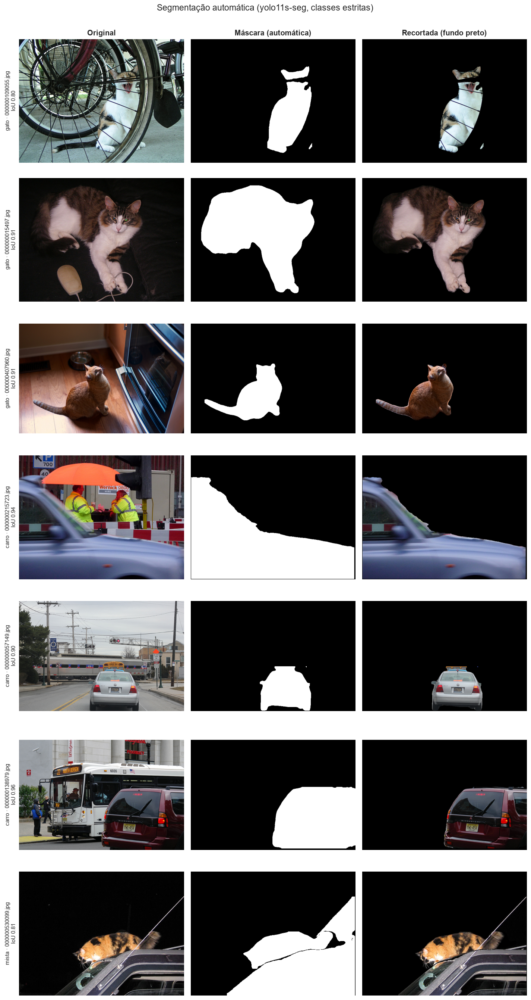

<details>
<summary>Piores máscaras do treino + validação</summary>

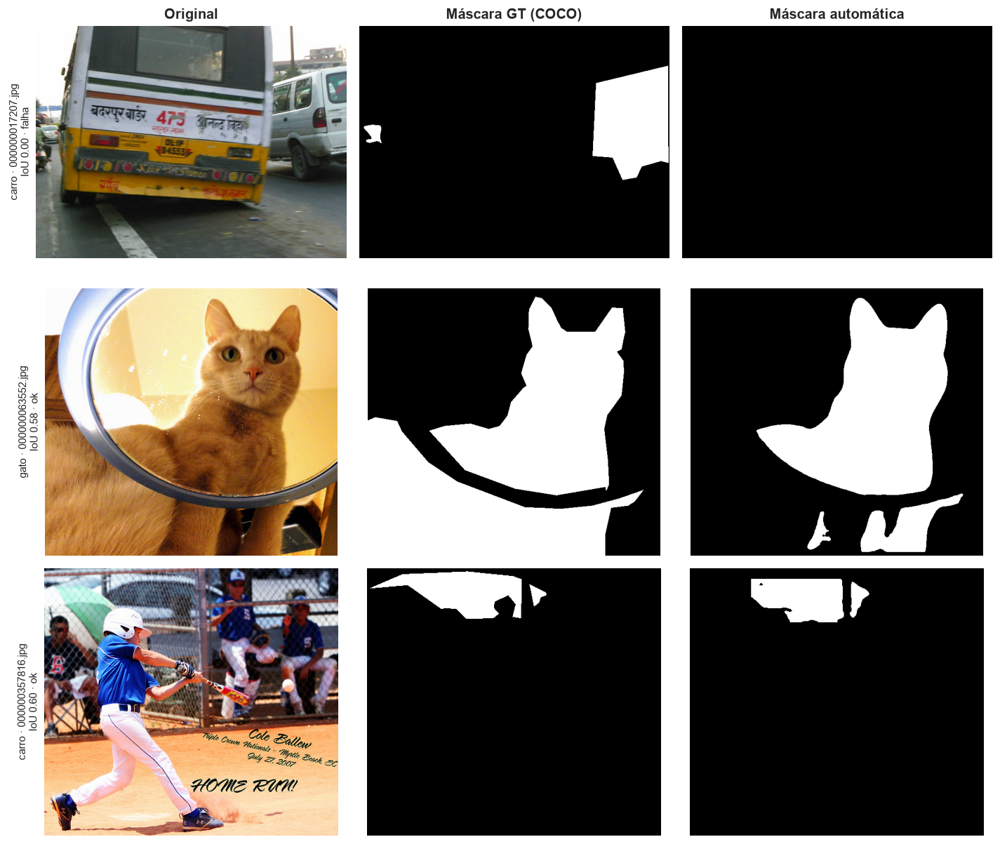

</details>

### H1 — Transfer Learning × CNN do zero (notebook 01)

| | CNN do zero | EfficientNetB0 (TL + fine tuning) |
|---|---|---|
| Acurácia | 0,785 ± 0,053 | **0,988 ± 0,011** |
| F1 macro | 0,782 ± 0,058 | **0,988 ± 0,011** |
| Log-loss (↓) | 0,608 ± 0,101 | **0,039 ± 0,005** |
| Brier (↓) | 0,165 | **0,008** |
| Teste original (8 imagens) | 0,900 ± 0,056 | **1,000** |
| Latência em CPU¹ | 75 ms/img | 587 ms/img |

¹ Notebook 01, Seção 7.7. Medidas em outra sessão (notebook 03, Seção 9), as mesmas latências foram 27 e 247 ms: em CPU
elas variam até ~2,7× com a carga da máquina. Compare só valores da mesma tabela; a razão TL/CNN (~8–9×) é estável.

- No consenso das 5 sementes, o TL acerta 52/52 e a CNN 42/52 (IC95% 0,69–0,90). As 10 imagens em que os modelos discordam
  favorecem todas o TL (McNemar exato, p = 0,002; 0,004 após Holm).
- A EfficientNetB0 original, **sem nenhum treino** (cabeça de 1.000 classes da ImageNet, somando as classes de gato contra as
  de carro), já acerta 64/64 do treino e 8/8 da validação. Só com a cabeça treinada (fase 1), acerta 0,981 do teste
  ampliado; o fine tuning reduz o log-loss de 0,076 para 0,039.
- A CNN do zero volta a errar o gato siamês sobre o notebook (`000000425390.jpg`), como na Entrega 2.
- O atalho "pessoa na cena" não explica os erros da CNN (carros com pessoa: 81% de acerto; sem pessoa: 90%); o erro
  dominante é chamar gato de carro (recall de gato 0,73).

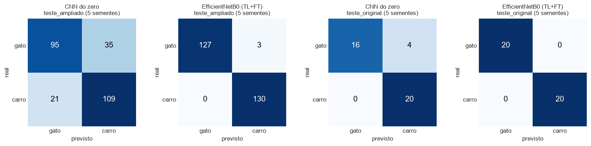

### H2 — matriz 2×2 e ablações (notebook 03)

| Classificador | Original (O) | **Segmentada (S)** | Recorte (C) | Oráculo (G) |
|---|---|---|---|---|
| CNN do zero | 0,785 ± 0,053 | **0,854 ± 0,022** | 0,838 ± 0,037 | 0,885 ± 0,014 |
| EfficientNetB0 | 0,988 ± 0,011 | **1,000 ± 0,000** | 0,973 ± 0,011 | 1,000 ± 0,000 |

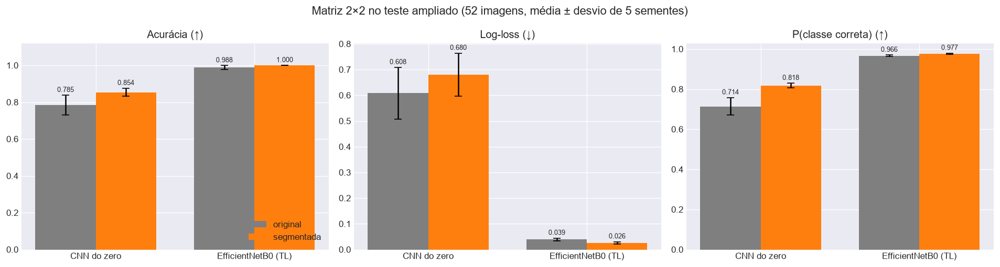

- **CNN:** +6,9 p.p. com a segmentação, desvio entre sementes de 0,053 para 0,022, Brier de 0,165 para 0,119 e 8/8 no teste
  original (inclusive o siamês). O ganho vem dos gatos (recall 0,73 → 0,88; no consenso, 0,77 → 0,92); nos carros o saldo é
  nulo (3 passam a acertar, 3 passam a errar). No consenso, 8 imagens passam a acertar e 4 passam a errar (IC95% da
  acurácia: O 0,69–0,90 e S 0,79–0,96; McNemar p = 0,39, 0,78 após Holm): com 52 imagens, a melhora não é significativa.
  O log-loss não melhora (0,61 → 0,68) porque os erros que restam são confiantes.
- **TL:** já estava no teto (no consenso, 52/52 nas duas condições); só a confiança melhora (log-loss 0,039 → 0,026).
- **Recorte (C)** não supera S, então o ganho não vem de ampliar o objeto. O **oráculo (G)** sugere que uma máscara melhor
  ajudaria a CNN: média 0,885 contra 0,854 (maior em todas as sementes, mas igual no consenso) e log-loss 0,384 contra 0,68.
  Como G usa a máscara humana também no teste, não é um pipeline alcançável.
- **Atalho da área:** um limiar sobre a fração visível da imagem segmentada, aprendido no treino, acerta 0,673. A CNN em S
  vai além disso.
- **Mudança de distribuição:** a CNN treinada em imagens originais e testada em segmentadas cai para 0,504 (acaso); o TL
  cai pouco (0,985). Por isso cada célula da matriz treina e testa na mesma condição.
- **Custo:** na mesma sessão de medição, a segmentação acrescenta ~250 ms por imagem em CPU (CNN: 27 → 278 ms; TL: 247 →
  501 ms). Medida isolada no notebook 02, em outra sessão, a segmentação levou 366 ms.

**CAM (exemplos ilustrativos, semente 42).** Os dois gatos da figura foram escolhidos entre os erros da CNN na imagem
original: nela, o mapa de ativação cai sobre o fundo (persiana, tapete) e a rede responde "carro"; com o fundo apagado, cai
sobre o gato. As duas fotos de carro têm um cão na cena, e nelas a CNN segmentada responde "gato" (`000000421455` erra nas
duas condições em todas as sementes; `000000017029` erra em S em 2 das 5): apagar o fundo não resolve quando há outro
animal junto do carro. O TL olha o objeto-alvo nas duas condições.

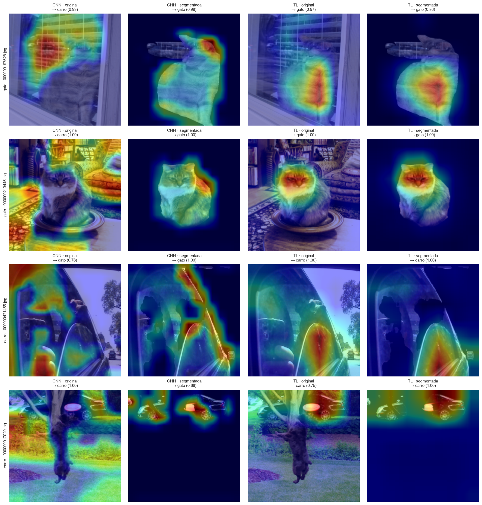

<details>
<summary>Métricas por classe, matrizes de confusão e curvas de treino</summary>

| Teste ampliado | P gato | R gato | F1 gato | P carro | R carro | F1 carro |
|---|---|---|---|---|---|---|
| CNN · O | 0,820 | 0,731 | 0,767 | 0,766 | 0,838 | 0,797 |
| CNN · S | 0,842 | 0,877 | 0,857 | 0,875 | 0,831 | 0,850 |
| TL · O | 1,000 | 0,977 | 0,988 | 0,978 | 1,000 | 0,989 |
| TL · S | 1,000 | 1,000 | 1,000 | 1,000 | 1,000 | 1,000 |

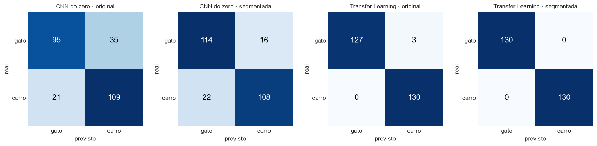

Na condição O, a perda de validação da CNN sobe a partir da época ~15 (overfitting) e a do TL ainda cai na época 60. Na
condição S, a da CNN sobe cedo e oscila muito, e a do TL fica estável durante o fine tuning.

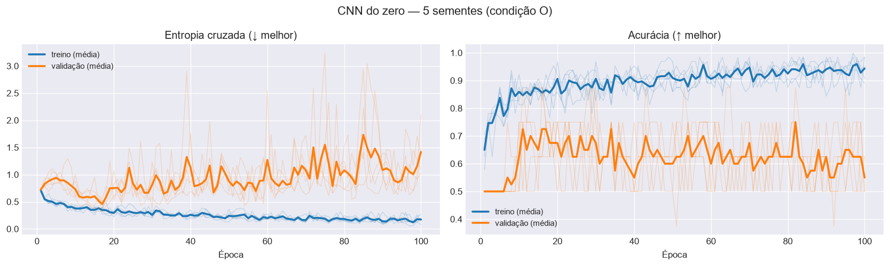
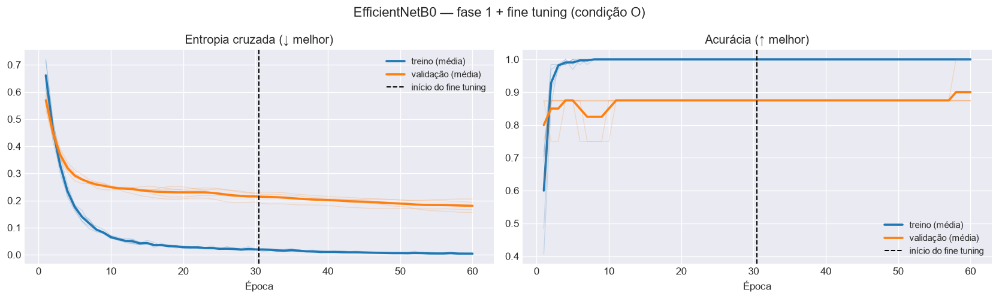
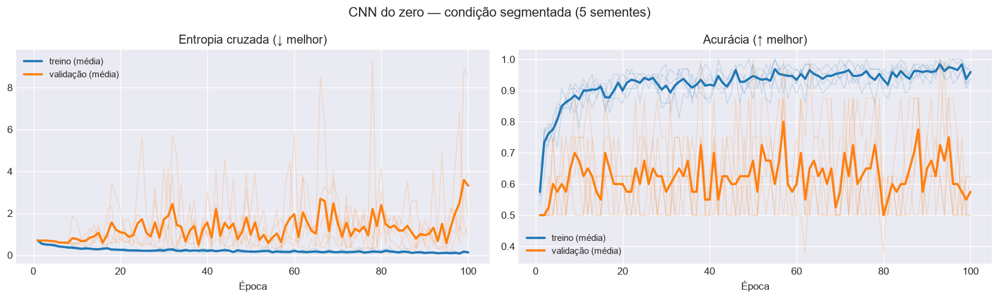
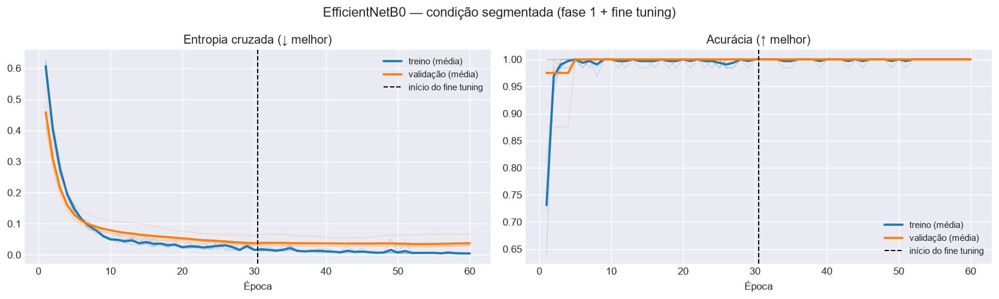

</details>

## Conclusões

| Hipótese | Resposta | Evidência principal |
|---|---|---|
| **H1:** a rede grande pré-treinada é melhor que a CNN do zero? | **Sim** | 0,988 × 0,785 no teste ampliado (McNemar p = 0,002; 0,004 após Holm); desvio entre sementes ~5× menor e probabilidades muito melhores (log-loss 0,039 × 0,608) |
| **H2:** pré-segmentar facilita a classificação? | **Parcialmente** | Tende a ajudar a CNN do zero (+6,9 p.p., Brier 0,165 → 0,119, gatos 0,73 → 0,88 de recall, siamês corrigido), mas sem significância (p = 0,39; 0,78 após Holm) e com log-loss pior; no TL, que já estava no teto, só aumenta a confiança |

Para gato e carro, quem decide a maior parte da tarefa é o pré-treino: a EfficientNetB0 já separa as classes sem treino
(64/64 no zero-shot do treino) e o segmentador do COCO, sozinho, acertaria 94% das imagens. A pré-segmentação é mais útil
para um modelo pequeno, treinado com poucas imagens, que tende a usar o fundo como atalho, como mostram os gatos.

## Limitações e próximos passos

- **Poder estatístico:** com 52 imagens, o McNemar detecta 6 discordâncias num só sentido (6 × 0: p = 0,031), mas não um
  saldo de 4 com discordâncias nos dois sentidos (8 × 4: p = 0,39), como na H2 da CNN.
- **Classes "em casa":** gato e carro existem na ImageNet e no COCO. Para objetos do agronegócio fora desses conjuntos, as
  vantagens do pré-treino e do segmentador tendem a ser menores. Próximo passo: repetir com classes inéditas.
- **Segmentador com classes:** ele só segmenta objetos das classes-alvo, e o val2017 é usado pela Ultralytics para
  validar os pesos (IoU possivelmente otimista). Próximo passo: SAM com caixas de um detector genérico.
- **CPU:** os tempos variaram com a carga da máquina. Um treino (CNN, condição C, semente 45) levou 9,6 h, quase todas
  paradas por uma suspensão do sistema (as outras execuções da CNN em C levaram 9 a 16 min); acurácias não são afetadas.
  As latências são de CPU.
- **Ablação da Entrega 1 → SAM 2.1:** implementada, mas não executada nem testada de ponta a ponta (requer GPU ou os pesos
  originais da Entrega 1).
- **Fine tuning:** na condição O, a perda de validação ainda caía na época 60 em 4 de 5 sementes (em S, o mínimo veio entre
  as épocas 43 e 55); vale testar mais épocas na fase 2.
- **Nota de processo:** numa execução preliminar de desenvolvimento, com o código anterior às correções da revisão, as
  métricas de validação e dos dois testes de uma semente da CNN foram conferidas como verificação de sanidade. Nenhum
  hiperparâmetro foi alterado depois disso; as correções vieram da revisão do código.

## Como executar

**Colab:** abra os notebooks na ordem 01 → 02 → 03 pelos botões acima, com GPU (`Runtime → Change runtime type → T4 GPU`).
Os botões apontam para o ramo `main` e passam a funcionar quando o PR do Ir Além for integrado; antes disso, abra os
notebooks pelo ramo `ir-alem-opcao2`. A primeira célula de cada um monta o Google Drive, clona este repositório (ramo
`main`; se ele ainda não tiver o Ir Além, o ramo `ir-alem-opcao2`) e instala o que falta. Imagens, máscaras, pesos e CSVs
ficam em `MyDrive/FarmTech_Fase6/ir_alem/` (~1 GB); execuções já concluídas com o mesmo código são reaproveitadas se a
sessão cair. As figuras e CSVs gerados no Colab também são copiados para `MyDrive/FarmTech_Fase6/ir_alem/para_o_repo/`.

**Local** (como na execução de referência; no Linux/macOS, troque `.venv/Scripts/python` por `.venv/bin/python`):

```bash
python -m venv .venv
.venv/Scripts/python -m pip install -r ir_alem_opcao2/requirements.txt
cd ir_alem_opcao2/notebooks
for nb in 01_transfer_learning 02_segmentacao_mascaras 03_comparacao_final; do
  ../../.venv/Scripts/python -m jupyter nbconvert --to notebook --execute --inplace --ExecutePreprocessor.timeout=-1 $nb.ipynb
done
```

A ordem importa: o 03 lê os pesos do 01 e as máscaras do 02. Na execução de referência em CPU, o 01 levou ~2 h, o 02 ~20
min e o 03 ~4 h de processamento. Os dados (~1 GB) vão para `ir_alem_opcao2/_dados/`, ignorado pelo git.

### Onde ficam os pesos

Os pesos não são versionados (`.gitignore`): os 40 classificadores somam ~580 MB (20 EfficientNetB0 de ~26 MB e 20 CNN de
~3 MB, em `.weights.h5`), e os segmentadores são baixados automaticamente pelo pacote `ultralytics`. Cada notebook grava
os pesos em `_dados/modelos/` (local) ou no Drive (Colab) e os reaproveita nas etapas seguintes. Os CSVs com todas as
previsões, imagem a imagem, estão em [`resultados/`](resultados/).

## Estrutura

```
ir_alem_opcao2/
├── README.md
├── requirements.txt
├── notebooks/        01_transfer_learning · 02_segmentacao_mascaras · 03_comparacao_final
├── src/              config, ambiente, dados, aumento, modelos, treino, segmentacao, metricas, visualizacao
├── dados/            manifesto_teste_ampliado.csv
├── resultados/       CSVs das execuções (previsões, métricas, segmentação, latência)
└── assets/           figuras geradas pelos notebooks (as principais aparecem neste README)
```

## Créditos das imagens

As imagens são do COCO 2017 val2017, publicadas no Flickr sob licenças Creative Commons individuais. A URL e a licença de
cada uma estão em [`resultados/imagens.csv`](resultados/imagens.csv). As figuras deste README são adaptações (máscara
aplicada, fundo removido, sobreposição de CAM) e usam só imagens cuja licença permite obras derivadas; as que vêm de
imagens com licença ShareAlike seguem a mesma licença.

## Referências

- Lin, T.-Y. et al. **Microsoft COCO: Common Objects in Context**. ECCV, 2014.
- Tan, M.; Le, Q. **EfficientNet: Rethinking Model Scaling for Convolutional Neural Networks**. ICML, 2019.
- Kirillov, A. et al. **Segment Anything**. ICCV, 2023. Ravi, N. et al. **SAM 2: Segment Anything in Images and Videos**. 2024.
- Zhou, B. et al. **Learning Deep Features for Discriminative Localization** (CAM). CVPR, 2016.
- Keras. **Transfer learning & fine-tuning**. <https://keras.io/guides/transfer_learning/>
- Ultralytics. **YOLO11 / YOLO26 e SAM 2**. <https://docs.ultralytics.com>
